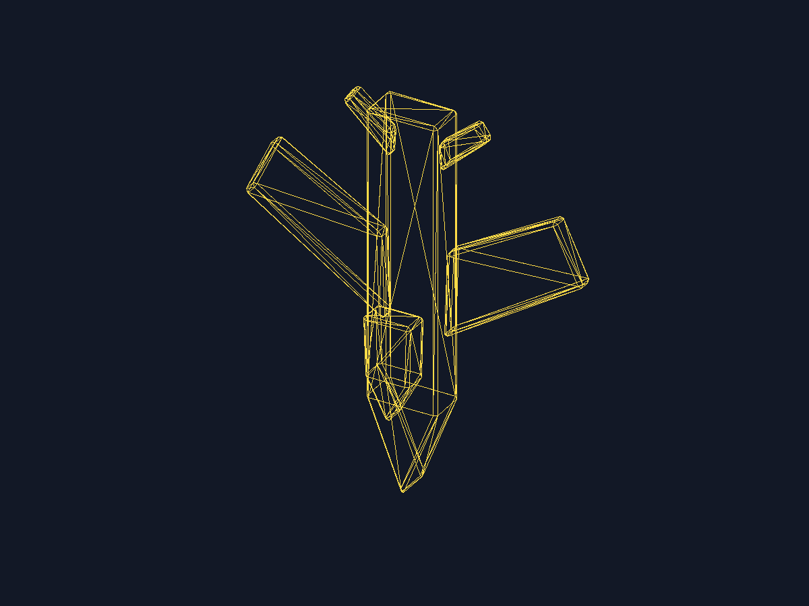

# Lab 4: Carga de modelos

Programa C++17 con SDL2 y GLM que carga `nave_espacial.obj` en vectores `glm::vec3`, obtiene las caras desde el archivo, descompone cada cara en triángulos en forma de abanico y rasteriza sus aristas centradas en el framebuffer.

## Requisitos

- SDL2 (probado con 2.32.72)
- compilador C++17
- GLM (instalación Homebrew: `brew install glm`)

## Compilar y ejecutar

```sh
c++ -std=c++17 -O2 main.cpp $(sdl2-config --cflags --libs) -I$(brew --prefix glm)/include -o lab4
./lab4 nave_espacial.obj
```

El programa crea la ventana SDL2 y guarda `captura_render.bmp` en el directorio actual. Al cerrar la ventana, termina.

Para generar la evidencia sin abrir ventana en macOS:

```sh
SDL_VIDEODRIVER=dummy ./lab4 nave_espacial.obj
sips -s format png captura_render.bmp --out nave_render.png
```

## Archivos

- `main.cpp`: lector OBJ, framebuffer, función triangle y presentación SDL2
- `nave_espacial.obj`: copia del modelo del Lab 3
- `nave_render.png`: resultado renderizado incluido en este repositorio

## Render


